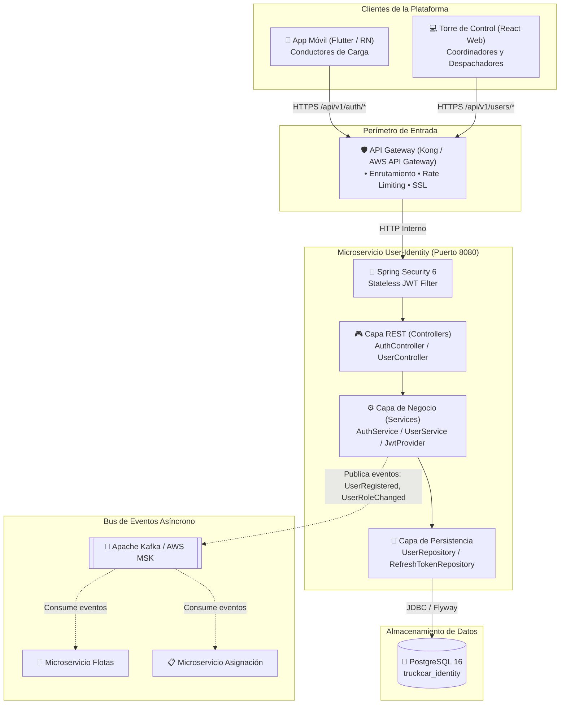
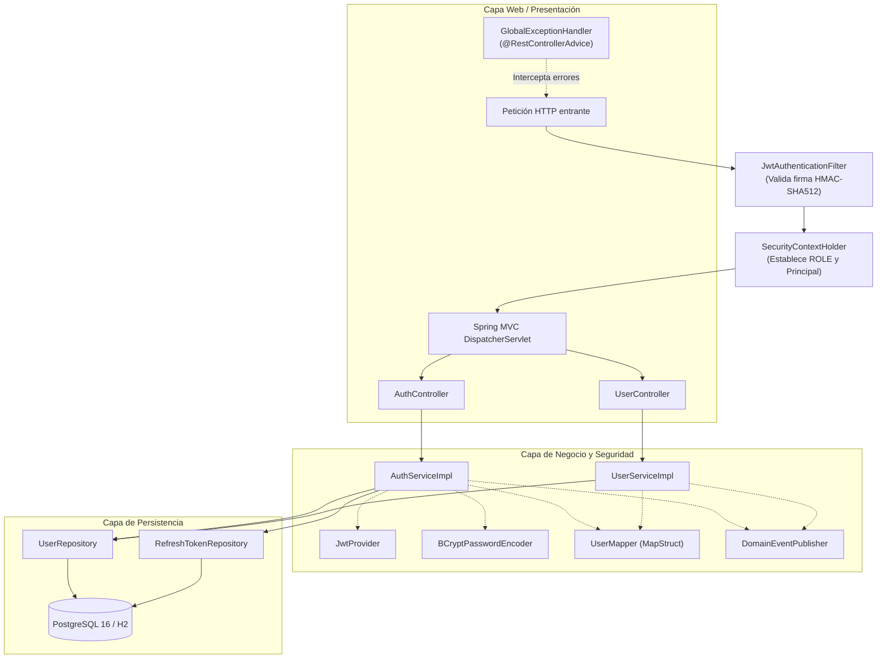
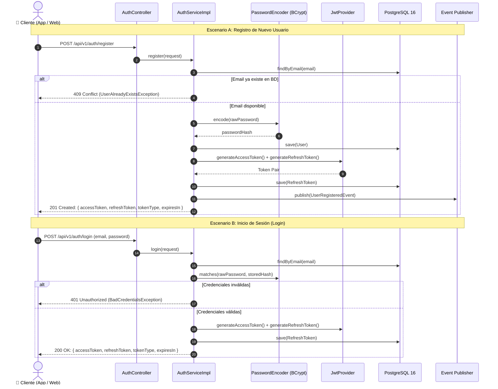
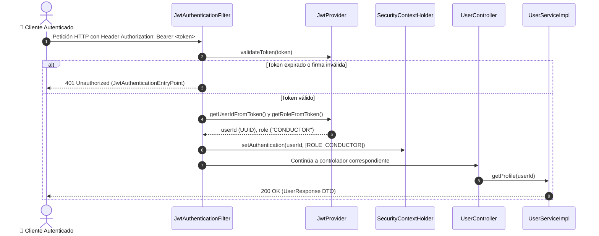
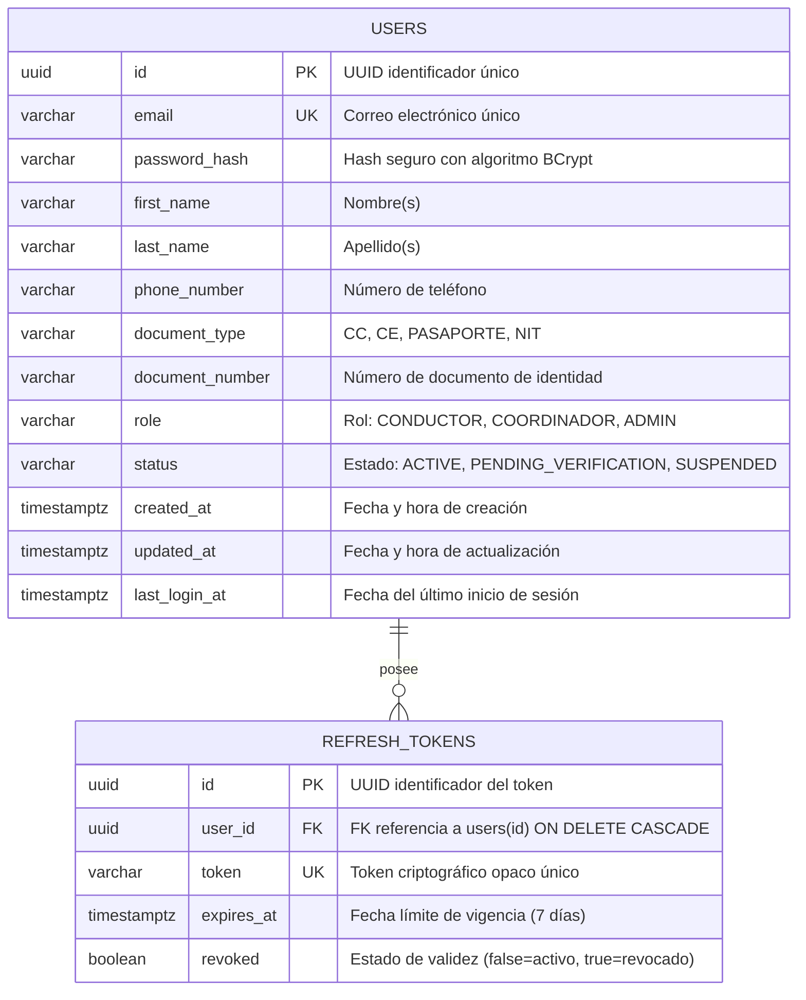

# TruckCar — User-Identity Microservice

Microservicio de **identidad, autenticación y autorización** de la plataforma
TruckCar. Gestiona el ciclo de vida de usuarios (conductores, coordinadores,
administradores), autenticación JWT (access + refresh tokens) y publica
eventos de dominio al bus de eventos compartido.

---

## Stack

| Tecnología | Versión |
|---|---|
| Java | 21 |
| Spring Boot | 3.3.5 |
| PostgreSQL | 16 |
| Flyway | Migraciones versionadas |
| JWT | jjwt 0.12.6 |
| MapStruct | 1.5.5.Final |
| Docker | Multi-stage build |

---

## Arquitectura del Microservicio

### 1. Diagrama de Contexto (Ecosistema TruckCar)



### 2. Arquitectura Interna por Capas



### 3. Flujo de Autenticación y Autorización (JWT)

#### 3.1. Flujo de Registro e Inicio de Sesión (Emisión de Tokens)



#### 3.2. Flujo de Validación de Petición Protegida y Control de Acceso (RBAC)



### 4. Modelo Entidad-Relación (Base de Datos)



---

## Requisitos previos

- **Java 21** (JDK)
- **Maven 3.9+** (o usar el wrapper `./mvnw`)
- **Docker** y **Docker Compose**

---

## Levantar localmente

### 1. Iniciar PostgreSQL con Docker Compose

```bash
docker compose up -d postgres
```

Esto levanta PostgreSQL en `localhost:5432` con:
- DB: `truckcar_identity`
- User: `truckcar`
- Password: `truckcar`

> **Tip:** También puedes levantar pgAdmin en `localhost:5050` con
> `docker compose up -d pgadmin`

### 2. Compilar y ejecutar el servicio

```bash
# Compilar (sin tests)
./mvnw clean package -DskipTests

# Opción A: Probar rápidamente en memoria (sin requerir Docker ni PostgreSQL)
./mvnw spring-boot:run "-Dspring-boot.run.profiles=standalone"

# Opción B: Ejecutar con PostgreSQL local (requiere Docker o Postgres en localhost:5432)
./mvnw spring-boot:run "-Dspring-boot.run.profiles=local"
```

El servicio arranca en `http://localhost:8080`.
*(En el modo `standalone`, la consola de base de datos H2 queda disponible en `http://localhost:8080/h2-console` con JDBC URL `jdbc:h2:mem:truckcar_identity` y usuario `sa`)*.

### 3. Acceder a Swagger UI

```
http://localhost:8080/swagger-ui.html
```

---

## Ejecutar tests

### Tests unitarios

```bash
./mvnw test
```

### Tests de integración (requiere Docker para Testcontainers)

```bash
./mvnw verify
```

> Los tests de integración usan **Testcontainers** para levantar una
> instancia de PostgreSQL real automáticamente — no necesitas tener
> Postgres corriendo manualmente.

---

## Build con Docker

```bash
# Construir la imagen
docker build -t truckcar/user-identity:latest .

# Secreto JWT compartido con api-gateway y Notifications (Base64, >= 256 bits).
# Genérelo una vez, use el mismo valor en los tres servicios y nunca lo versione.
export TRUCKCAR_JWT_SECRET="$(openssl rand -base64 64 | tr -d '\n')"

# Ejecutar el contenedor
docker run -p 8080:8080 \
  -e DB_URL=jdbc:postgresql://host.docker.internal:5432/truckcar_identity \
  -e DB_USERNAME=truckcar \
  -e DB_PASSWORD=truckcar \
  -e TRUCKCAR_JWT_SECRET="$TRUCKCAR_JWT_SECRET" \
  -e SPRING_PROFILES_ACTIVE=local \
  truckcar/user-identity:latest
```

---

## Endpoints principales

| Método | Ruta | Descripción |
|---|---|---|
| `POST` | `/api/v1/auth/register` | Registro de usuario: `CONDUCTOR`, `GENERADOR` o `TRANSPORTADORA` (`COORDINADOR` y `ADMIN` responden 400) |
| `POST` | `/api/v1/auth/login` | Login (access + refresh token) |
| `POST` | `/api/v1/auth/refresh` | Renovar access token |
| `POST` | `/api/v1/auth/logout` | Revocar refresh token |
| `GET` | `/api/v1/users/me` | Perfil del usuario autenticado |
| `PUT` | `/api/v1/users/me` | Actualizar perfil propio |
| `GET` | `/api/v1/users/{id}` | Consultar usuario (ADMIN/COORDINADOR) |
| `GET` | `/api/v1/users` | Listado paginado (ADMIN) |
| `PATCH` | `/api/v1/users/{id}/status` | Suspender/reactivar (ADMIN) |
| `PATCH` | `/api/v1/users/{id}/role` | Cambiar rol (ADMIN) |

### Doble autenticación (2FA con TOTP)

Es opcional y cada usuario la activa desde su perfil. Las cuentas existentes la tienen desactivada (migración V5) y
siguen iniciando sesión solo con correo y contraseña. Funciona con Google Authenticator, Authy o Microsoft
Authenticator: TOTP (RFC 6238), HMAC-SHA1, 6 dígitos y pasos de 30 s. No usa SMS ni correo.

| Método | Ruta | Quién | Descripción |
|---|---|---|---|
| `POST` | `/api/v1/auth/2fa/setup` | sesión completa | Genera un secreto pendiente: `secret` (Base32), `otpauthUri` y `qrImage` (SVG en data URI). No activa el 2FA. Responde 409 si ya está activo |
| `POST` | `/api/v1/auth/2fa/verify-setup` | sesión completa | `{"code": "123456"}` con el primer código de la app. Activa el 2FA y devuelve **una sola vez** 8 `backupCodes` (`XXXX-XXXX`) |
| `POST` | `/api/v1/auth/2fa/disable` | sesión completa | `{"password": "…"}` o `{"code": "…"}` (TOTP o de respaldo). Desactiva el 2FA y cierra las demás sesiones |
| `POST` | `/api/v1/auth/2fa/verify-login` | público (token temporal) | `{"tempToken": "…", "code": "…"}`. Con un código TOTP o de respaldo emite `accessToken` y `refreshToken` |

**Login en dos pasos:**
- Si el usuario tiene 2FA, `POST /api/v1/auth/login` no emite la sesión. Responde
  `200 {"requiresTwoFactor": true, "tempToken": "…", "expiresIn": 300}`.
- El `tempToken` dura 5 minutos, lleva `scope: 2FA_PENDING`, no lleva rol y se firma con una llave derivada del secreto JWT.
- Por eso no autentica en ningún endpoint: el api-gateway, Notifications y este mismo servicio lo rechazan.

**Seguridad:**
- **Secretos cifrados:** el secreto TOTP se guarda cifrado con AES-256-GCM. La llave es `TRUCKCAR_TOTP_ENCRYPTION_KEY` o, si no se define, una derivada de `TRUCKCAR_JWT_SECRET`. Si cambia la llave, los usuarios con 2FA deben configurarlo de nuevo.
- **Códigos de respaldo:** se guardan como SHA-256, igual que los refresh tokens, y cada uno sirve una vez.
- **Tolerancia del reloj:** se acepta ±1 paso de 30 s.
- **Sin repetición:** un código ya usado no se acepta otra vez (RFC 6238 §5.2).
- **Bloqueo:** tras 5 códigos inválidos seguidos, el segundo paso queda bloqueado 15 minutos (429 `2fa-locked`). Se configura con `TRUCKCAR_2FA_MAX_FAILED_ATTEMPTS` y `TRUCKCAR_2FA_LOCKOUT_MS`. Además, el api-gateway aplica a `verify-login` el mismo límite de intentos que al login.
- **Errores:** RFC 7807 con los tipos `invalid-2fa-code`, `invalid-2fa-token`, `2fa-locked`, `2fa-already-enabled`, `2fa-not-enabled`, `2fa-setup-missing` y `2fa-disable-denied`.

`/users/me` incluye `twoFactorEnabled`.

### Recuperar la contraseña (código al correo)

| Método | Ruta | Cuerpo | Respuesta |
|---|---|---|---|
| `POST` | `/api/v1/auth/password/forgot` | `{"email"}` | **202**, siempre la misma respuesta, exista o no la cuenta |
| `POST` | `/api/v1/auth/password/verify` | `{"email", "code"}` | `{"resetToken", "expiresInSeconds": 600}` |
| `POST` | `/api/v1/auth/password/reset` | `{"resetToken", "newPassword"}` | 200, y se cierran todas las sesiones abiertas |

**El código:**
- Tiene 6 dígitos y vale **10 minutos** (`Su código para cambiar la contraseña de TruckCar: 482913`).
- Se guarda como HMAC-SHA256 con una llave derivada del secreto JWT, nunca en claro.
- Pedir uno nuevo invalida el anterior.

**Límites:**
- Un código por minuto y cinco por hora por cuenta. Además, el gateway limita los intentos por IP.
- A los **5 códigos equivocados** el código se invalida (429 `reset-code-locked`).

**Después de verificar:**
- `verify` entrega un token de un solo uso: 32 bytes al azar, guardado como SHA-256, que vence en 10 minutos.
- `reset` exige la misma regla de contraseña del registro (8 a 72 caracteres).

**Sin revelar cuentas:**
- Un correo sin cuenta, una cuenta suspendida o un código vencido o equivocado responden igual.
- El envío es asíncrono, así que la respuesta tarda lo mismo en todos los casos.

**Errores:** RFC 7807 `invalid-reset-code`, `reset-code-locked` e `invalid-reset-token`.

**El correo:**
- Se envía por SMTP: Gmail en `smtp.gmail.com:587` con STARTTLS y una **contraseña de aplicación**.
- Las credenciales van solo en el `.env` (ver variables).
- Sin `SMTP_HOST` no se envía nada y queda un aviso en el log, sin el código.

### Empresas transportadoras y afiliación de conductores

Un conductor es **independiente** o **de empresa**:
- El **independiente** usa la navegación para camión, las rutas y las alertas, pero no recibe cargas.
- El **de empresa** recibe cargas solo cuando su transportadora lo acepta (afiliación `ACTIVA`) y su cuenta está verificada (`ACTIVE`).

Las cuentas creadas antes de la afiliación no tienen tipo y siguen recibiendo cargas como antes.

| Método | Ruta | Quién | Descripción |
|---|---|---|---|
| `GET` | `/api/v1/auth/companies` | público | Catálogo (`id`, `name`) para que el conductor de empresa elija su transportadora al registrarse |
| `GET` | `/api/v1/companies` | ADMIN, COORDINADOR | Transportadoras con `activeDrivers` y `pendingRequests` |
| `GET` | `/api/v1/companies/me` | TRANSPORTADORA | Datos de su empresa y conteos |
| `GET` | `/api/v1/companies/me/drivers` | TRANSPORTADORA | Sus conductores afiliados y las solicitudes |
| `POST` | `/api/v1/companies/me/drivers` | TRANSPORTADORA | Registra un conductor propio, que nace con la afiliación `ACTIVA` y la cuenta `PENDING_VERIFICATION` (la plataforma la verifica aparte) |
| `PATCH` | `/api/v1/companies/me/drivers/{driverId}/affiliation` | TRANSPORTADORA | `{"status": "ACTIVA"}` para aceptar o `{"status": "RECHAZADA"}` para rechazar una solicitud |
| `DELETE` | `/api/v1/companies/me/drivers/{driverId}` | TRANSPORTADORA | Desvincula al conductor, que queda independiente |
| `PUT` | `/api/v1/users/me/affiliation` | CONDUCTOR | `{"driverType": "INDEPENDIENTE"}` o `{"driverType": "EMPRESA", "companyId": "…"}`, que deja la solicitud `PENDIENTE` |

**Campos de registro:**
- Conductor: `driverType` (`INDEPENDIENTE` o `EMPRESA`) y, si es de empresa, `companyId`.
- Transportadora: `companyName` y `companyNit`. El NIT se guarda solo con dígitos y sin el dígito de verificación; si ya existe, responde 409.

**Perfil** (`/users/me` y los listados): incluye `driverType`, `companyId`, `companyName`, `affiliationStatus` y `loadEligible`.

**Evento `user.affiliation.changed`** (tópico de eventos de usuario):
- Campos: `userId`, `driverType`, `companyId`, `companyName`, `affiliationStatus`, `loadEligible`.
- Se publica al registrarse un conductor con tipo, cuando la empresa acepta, rechaza o desvincula, cuando el conductor cambia de tipo, y al arrancar como fotografía.
- fleets-drivers y load-allocation lo usan para que solo un conductor con `loadEligible: true` reciba cargas.

---

## Variables de entorno

| Variable | Descripción | Default |
|---|---|---|
| `DB_URL` | JDBC URL de PostgreSQL | `jdbc:postgresql://localhost:5432/truckcar_identity` |
| `DB_USERNAME` | Usuario de la BD | `truckcar` |
| `DB_PASSWORD` | Contraseña de la BD | `truckcar` |
| `TRUCKCAR_JWT_SECRET` | Secreto para firmar JWTs (Base64, >= 256 bits). Debe ser **el mismo** en User-Identity, api-gateway y Notifications | *(obligatorio: sin él el servicio no arranca)* |
| `JWT_SECRET` | Nombre heredado del secreto; solo se usa si `TRUCKCAR_JWT_SECRET` no está definido | — |
| `JWT_ACCESS_EXPIRATION` | TTL del access token (ms) | `900000` (15 min) |
| `JWT_REFRESH_EXPIRATION` | TTL del refresh token (ms) | `604800000` (7 días) |
| `SERVER_PORT` | Puerto del servidor | `8080` |
| `SMTP_HOST`, `SMTP_PORT` | Servidor SMTP del correo de recuperación (Gmail: `smtp.gmail.com`, `587`) | sin valor (no se envía) / `587` |
| `SMTP_USERNAME`, `SMTP_PASSWORD` | Cuenta y **contraseña de aplicación** de Gmail. Solo en el `.env` | — |
| `TRUCKCAR_MAIL_FROM` | Remitente del correo | `SMTP_USERNAME` |

---

## Estructura del proyecto

```
src/main/java/escuelaing/edu/co/truckcar/User_Identity/
├── controller/          # REST controllers
├── service/             # Interfaces de lógica de negocio
│   └── impl/            # Implementaciones
├── repository/          # Spring Data JPA repositories
├── model/               # Entidades JPA + enums
├── dto/
│   ├── request/         # DTOs de entrada
│   └── response/        # DTOs de salida
├── mapper/              # MapStruct (entity <-> DTO)
├── security/            # JWT filter, SecurityConfig
├── exception/           # Excepciones + GlobalExceptionHandler
├── config/              # OpenAPI, beans de configuración
├── event/               # Eventos de dominio + publisher
└── UserIdentityApplication.java
```

---

## Perfiles de Spring

| Perfil | Uso |
|---|---|
| `standalone` | Prueba rápida en memoria (H2, sin requerir Docker/Postgres) |
| `local` | Desarrollo local (SQL logging, PostgreSQL) |
| `dev` | Ambiente compartido de desarrollo |
| `prod` | Producción (ECS Fargate) |
| `test` | Tests de integración |